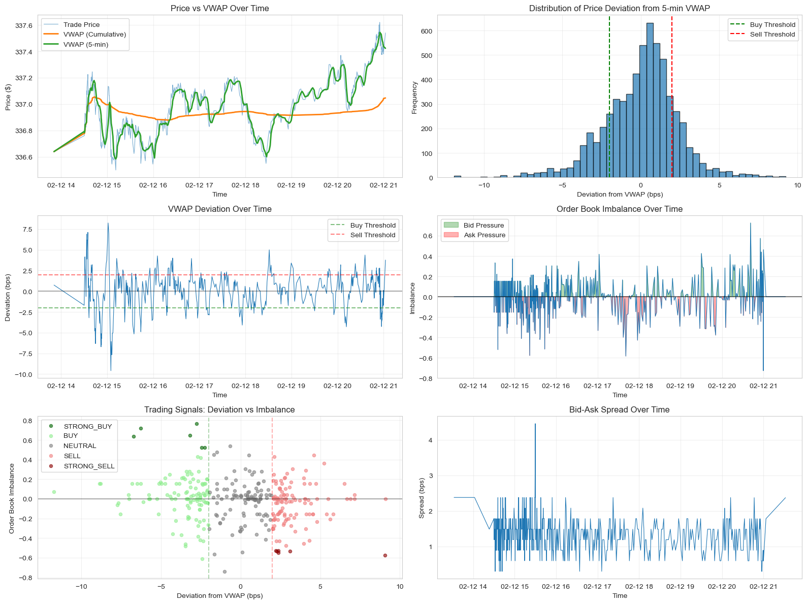
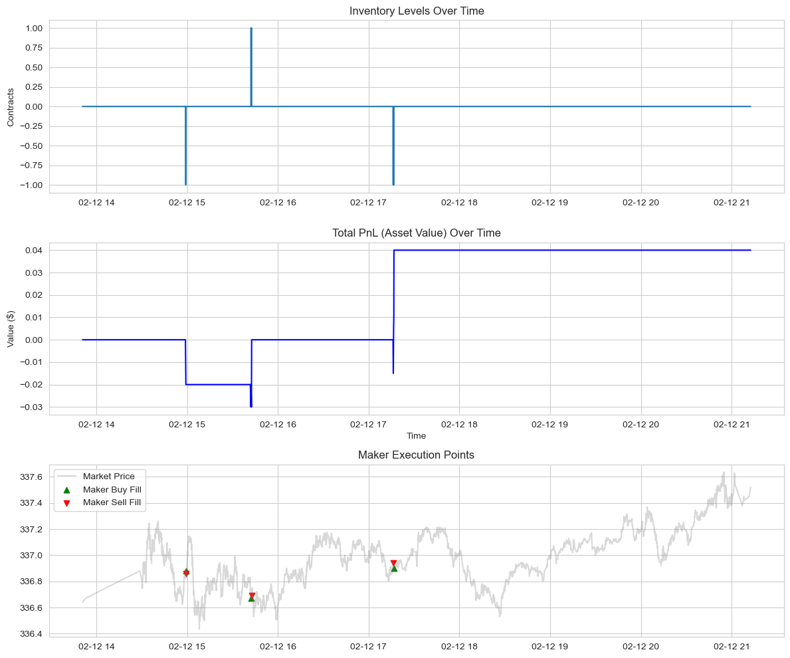

<h1 style="font-size: 3em; text-align: center;">FIN556 Report Group 4 – High-Frequency VWAP Strategy</h1>

- [1. Executive Summary](#1-executive-summary)
- [2. Meet the Team](#2-meet-the-team)
  - [Koki Yahata](#koki-yahata)
  - [Chia-Ning Chang](#chia-ning-chang)
  - [Ansh Bardoliwala](#ansh-bardoliwala)
  - [Howard Ding](#howard-ding)
- [3. Introduction to VWAP-Based Strategies](#3-introduction-to-vwap-based-strategies)
  - [3.1 VWAP Mean-Reversion Signal](#31-vwap-mean-reversion-signal)
  - [3.2 Maker vs. Taker Implementations](#32-maker-vs-taker-implementations)
- [4. Financial Instrument](#4-financial-instrument)
- [5. Market Data Analysis](#5-market-data-analysis)
- [6. Data Retrieval and Preprocessing](#6-data-retrieval-and-preprocessing)
  - [6.1 Order Book Updates (Quotes)](#61-order-book-updates-quotes)
  - [6.2 Trades and VWAP Construction](#62-trades-and-vwap-construction)
- [7. Strategy Design and Results](#7-strategy-design-and-results)
  - [7.1 Python Notebook Backtest (`vwap_based_strategy.ipynb`)](#71-python-notebook-backtest-vwap_based_strategyipynb)
  - [7.2 StrategyStudio Backtest (VwapOfiIndex1)](#72-strategystudio-backtest-vwapofiindex1)
- [8. Future Implications and Improvements](#8-future-implications-and-improvements)

---

# 1. Executive Summary

This project focuses on designing and evaluating a **high-frequency VWAP-based trading strategy**. In the Python research notebook we use **SPY** (2020‑02‑12) as a concrete example dataset, while the StrategyStudio C++ strategy is instrument-agnostic and runs on any configured symbol list with valid trade/quote data. The core idea is to exploit **short-lived deviations between the mid-price and a rolling VWAP**, under the assumption that prices tend to revert toward VWAP over short horizons. Using intraday **order book updates** (323,759 quotes) and **trades** (6,127 prints) from the SPY sample day, we build a microstructure-aware signal that combines:

- Deviation of the mid-price from a **5-minute rolling VWAP** in basis points (bps), and
- **Order book imbalance** as a confirmation of buy or sell pressure.

We ran **two backtests of two different strategies**:

- **Python notebook backtest (`vwap_based_strategy.ipynb`)**: a research prototype that generates VWAP/imbalance signals and simulates a **maker-style** execution model (resting limit orders at best bid/ask) under conservative “strong signal only” criteria. It produced only **6 fills** and a small positive PnL of about **$0.04**.
- **StrategyStudio C++ backtest (`src/VWAP.cpp`)**: A refined implementation that trades VWAP deviation as a **Market Maker** using limit orders on a multi-asset universe (**MSFT, AAPL**). Unlike previous taker-based iterations which suffered large losses, this version provides liquidity to capture the spread. The backtest on 2019-09-13 produced **65 fills** with a high fill rate and a **negligible net PnL of –$2.85**. This demonstrates that shifting to passive execution successfully eliminated the massive spread costs observed in earlier tests, though the signal itself requires further tuning to generate consistent alpha.

---

# 2. Meet the Team

We are Group 4 in FIN556, combining experience in **algorithmic trading**, **high-performance systems**, and **machine learning**.

## Koki Yahata

I am a senior majoring in Computer Science. My focus is in algorithmic trading and web3 development. I develop market making strategies and on-chain arbitrage strategies. I am familiar with Python, Rust, C++, TypeScript, and Solidity.

Email: kyahata2@illinois.edu  
LinkedIn: [Koki Yahata](https://www.linkedin.com/in/koki-yahata)

## Chia-Ning Chang

I am a master student in Finance. My focus is in algorithmic trading strategy design and Portfolio Management. I develop all weather macro strategies on equities and double carry strategies on futures. I am familiar with Python.

Email: cc173@illinois.edu 
LinkedIn: [Charlie Chang](https://www.linkedin.com/in/charlie-chianing-chang)

## Ansh Bardoliwala

I am a master’s student in Finance at the University of Illinois Urbana-Champaign. My focus is on algorithmic trading, market microstructure, and quantitative research. 
I work on data-driven trading strategies, order-book analysis, and transaction-cost modeling, with experience in Python-based backtesting and financial data analysis.

Email: apb8@illinois.edu 
LinkedIn: [Ansh Bardoliwala](https://www.linkedin.com/in/ansh-bardoliwala-ms-finance/) 

## Howard Ding

I am a senior majoring in Finance, Mathematics, and Statistics. My focus is on algorithmic trading, data science, and portfolio management. I am familiar with C++, Python, R, and SQL. 

Email: howardd2@illinois.edu 
LinkedIn: [Howard Ding](https://www.linkedin.com/in/hzding/) 

---

# 3. Introduction to VWAP-Based Strategies

## 3.1 VWAP Mean-Reversion Signal

The **Volume-Weighted Average Price (VWAP)** is a natural benchmark for intraday trading because it incorporates both **price** and **traded volume**. Our strategy assumes that when the observed mid-price drifts significantly away from a short-horizon VWAP, it is likely to **mean revert** in the near future.

From the notebook `vwap_based_strategy.ipynb`, we:

* **Compute VWAP Benchmarks:** We calculate rolling **1-minute** and **5-minute** VWAPs from trade data.
* **Calculate Metrics:** Each trade is aligned with the nearest quote to obtain a **mid-price** and **order book imbalance**.
* **Define VWAP Deviation:** Deviation is calculated in basis points (bps) relative to the 5-minute VWAP:

$$\text{Deviation (bps)} = \left( \frac{\text{Mid-Price}}{\text{VWAP}_{5\text{min}}} - 1 \right) \times 10,000$$

---

### Signal Generation Logic

The `generate_signals` function classifies each timestamp into five categories based on a **2 bps deviation threshold** and a **±0.5 order book imbalance filter**.

| Signal | Deviation from 5-min VWAP | Order Book Imbalance | Interpretation |
| :--- | :--- | :--- | :--- |
| **STRONG BUY** | $< -2$ bps | $> 0.5$ | Price significantly below VWAP with strong bid pressure. |
| **BUY** | $< -2$ bps | $\leq 0.5$ | Price significantly below VWAP. |
| **NEUTRAL** | $-2 \text{ bps} \leq \text{Dev} \leq 2 \text{ bps}$ | Any | Price is close to VWAP. |
| **SELL** | $> 2$ bps | $\geq -0.5$ | Price significantly above VWAP. |
| **STRONG SELL** | $> 2$ bps | $< -0.5$ | Price significantly above VWAP with strong ask pressure. |

> **Note on Aggressive Signals:** We also generate more sensitive signals using a **1-minute VWAP** window and a lower threshold of **1.5 bps** to capture faster mean-reversion opportunities.

---

### Signal Distribution

The resulting distribution highlights the rarity of extreme price-value dislocations:

* **NEUTRAL:** 66.2% (The majority of the time, price tracks VWAP closely).
* **BUY / SELL:** 17.5% and 16.0% respectively.
* **STRONG BUY / STRONG SELL:** 0.1% each (Extreme deviations combined with high imbalance are very rare).

## 3.2 Maker vs. Taker Implementations

We explored two ways of turning the VWAP signal into trades:

- **Notebook Maker Prototype (Limit Orders):** - Only **STRONG BUY** and **STRONG SELL** signals are used.  
  - When flat and a strong signal appears, we **rest a limit order** at the best bid (for long) or best ask (for short).  
  - A fill occurs if the next trade prints through our limit price.  
  - Inventory is tightly controlled (targeting flat) and the maximum inventory is capped at 10 units.

- **StrategyStudio VWAPStrategy (Limit Orders):** - Implemented in C++ (`VWAP.h` / `VWAP.cpp`) using RCM StrategyStudio.  
  - **Execution:** Shifts from aggressive taking to **passive making**. It places **Limit Orders** at the best bid or ask to capture the spread when the VWAP deviation signal is triggered.  
  - **Logic:** When deviation exceeds the entry threshold, the strategy places a non-marketable limit order. It manages active orders by canceling and replacing them if the price moves away, ensuring the strategy attempts to **earn the spread** (providing liquidity) rather than paying it.

**Important note (strategy difference):** The Python notebook strategy and the C++ StrategyStudio strategy now both employ **Maker-style** logic. However, the StrategyStudio implementation is a fully functional dynamic system that must handle order cancellations, replacements, and partial fills in a live event-driven environment, whereas the notebook is a simplified vectorised simulation.

---

# 4. Financial Instrument

The **StrategyStudio C++ implementation** (`src/VWAP.cpp`) is **not limited to a single instrument**; it registers for events across the configured symbol list and can be run on any instrument for which the backtest provides valid trades/quotes.

In our **Python notebook backtest**, we use **SPY** intraday data as a concrete, liquid example to study VWAP deviation behavior.

In the final **StrategyStudio backtest** reported here, we configured the strategy to run on **MSFT (Microsoft)** and **AAPL (Apple)** using intraday data from **September 13, 2019**. This multi-asset test demonstrates the strategy's capability to handle concurrent data streams and manage inventory across different symbols.

---

# 5. Market Data Analysis

The `vwap_based_strategy.ipynb` notebook performs several diagnostic analyses (using SPY data):

- **Price vs. VWAP Over Time:** A figure compares trade prices against cumulative and 5-minute rolling VWAP. Visually, the trade price oscillates around VWAP, with deviations mostly within **±10 bps**, reinforcing the idea of short-term mean reversion but also highlighting how small the edge is in absolute terms.

- **Distribution of VWAP Deviations:** A histogram of 5-minute deviation shows a roughly centered distribution with standard deviation around **2.38 bps**, and thresholds at ±2 bps capturing the outer tails of normal microstructure noise.

- **VWAP Deviation Over Time:** Time-series plots of deviation, with horizontal lines at ±2 bps, show that **strong signals** are clustered and infrequent. Most of the intraday period sits in the neutral band.

- **Order Book Imbalance Over Time:** The imbalance plot, shading positive (bid pressure) vs. negative (ask pressure), reveals alternating regimes of buy and sell pressure. This series is used as a **filter**, not a primary signal, to avoid trading mean-reversion in the wrong direction.

- **Signal Scatter Plot (Deviation vs. Imbalance):** A scatter of deviation vs. imbalance, colored by signal label, visually confirms that **STRONG BUY** points lie in the lower-left quadrant (large negative deviation + strong bid pressure) and **STRONG SELL** points lie in the upper-right (large positive deviation + strong ask pressure), matching our economic intuition.

Together, these plots demonstrate that the VWAP-based signal is **statistically coherent** but operates on **very small price edges** relative to spread and fees—making execution model choice (maker vs taker) a first-order driver of realized performance.

---

# 6. Data Retrieval and Preprocessing

## 6.1 Order Book Updates (Quotes)

The quote data (`20200212_book_updates.csv.gz`) contains best bid/ask prices and sizes (and deeper levels for some analyses). Preprocessing steps in the notebook include:

- Parsing timestamps into `COLLECTION_TIME` and sorting by time.  
- Computing:  
  - **Mid-price:** \((\text{Bid}_1 + \text{Ask}_1) / 2\)  
  - **Spread (dollars and bps)** - **Weighted mid-price** using the top three bid/ask levels  
  - **Bid/ask liquidity** and **order book imbalance** - Sampling quotes for plotting to keep visualizations readable while preserving intraday structure.

These features feed into both **signal generation** and diagnostic plots such as spread over time and imbalance heatmaps.

## 6.2 Trades and VWAP Construction

The trade data (`20200212_trades.csv.gz`) is used to compute:

- **Cumulative VWAP** from the start of the session, via running sums of price × size and volume.  
- **Rolling VWAPs** over 1-minute and 5-minute windows by filtering trades within a moving time window for each timestamp.  
- **Merged Trade–Quote Dataset** using `merge_asof`, aligning each trade to the latest quote to attach mid-price, spread, and imbalance.

From this merged dataset, we derive:

- **VWAP deviation** for multiple horizons (cumulative, 5-minute, 1-minute).  
- **Price momentum and percentage price changes.** - **Signal labels** (`STRONG_BUY`, `BUY`, `NEUTRAL`, `SELL`, `STRONG_SELL`) based on deviation and imbalance thresholds.  

The notebook also exports **`vwap_trading_signals.csv`** for later inspection and downstream backtesting.

---

# 7. Strategy Design and Results

## 7.1 Python Notebook Backtest (`vwap_based_strategy.ipynb`)

This section summarizes the backtest implemented in the Python notebook **`vwap_based_strategy.ipynb`** (research prototype).

### Strategy (Python): VWAP + Imbalance → Maker-style limit orders

Using VWAP signals computed from trades, we create discrete labels (`STRONG_BUY`, `BUY`, `NEUTRAL`, `SELL`, `STRONG_SELL`) based on:

- **Deviation threshold**: ±2 bps vs the **5-minute rolling VWAP**
- **Confirmation filter**: order book imbalance \(> 0.5\) for strong buy, \(< -0.5\) for strong sell

For the **maker backtest**, we only trade on **strong** signals and simulate passive execution:

- Enters only on **strong signals** (\(|\text{Deviation}| > 2 \text{ bps}\) and \(|\text{Imbalance}| > 0.5\)).  
- Places a **single-unit limit order** at the **best bid** (for `STRONG_BUY`) or **best ask** (for `STRONG_SELL`) when inventory is flat.  
- Considers the order **filled** if the next trade occurs at or through the limit price.  
- Prioritizes **liquidation**: if inventory is non-zero, it always places a closing limit order at the opposite side (best ask for long, best bid for short) before taking new signals.

### Results (Python backtest)

- **Total fills:** 6 trades  
- **Final inventory:** 0  
- **Total PnL:** approximately **$0.04** The PnL is small because the entry conditions are extremely selective: **only 0.1%** of timestamps are `STRONG_BUY` and **0.1%** are `STRONG_SELL`, resulting in very low turnover.

## 7.2 StrategyStudio Backtest (VwapOfiIndex1)

This section summarizes the final StrategyStudio backtest using the C++. We analyzed the backtest logs (`VwapOfiIndex1`) for a run on **September 13, 2019**, covering **MSFT** and **AAPL**.

### Implementation Highlights

- **Execution Style:** 100% **Maker**. The `fill.csv` log confirms that every single trade had `LiquidityAction: ADDED`.
- **Order Type:** 100% **Limit Orders**. The strategy avoids Market orders entirely to eliminate spread crossing costs.
- **Fill Efficiency:** The strategy placed **73 orders** and received **65 fills** (~89% fill rate), indicating that the limit order pricing logic successfully tracked the top of the book without excessive cancellations.

### Performance Analysis

- **PnL:** The strategy ended effectively **flat** with a small loss of **–$2.85**.
  - *Min PnL (Drawdown):* –$56.40
  - *Max PnL:* +$0.85
- **Execution Costs:** Total execution cost was only **$0.19**, a stark contrast to the thousands of dollars in fees paid by the earlier taker strategy variants.
- **Volume:** 65 total trades across both symbols.

### Interpretation

The shift from a Taker to a Maker strategy **successfully plugged the "cost leak."** By capturing the spread instead of crossing it, the strategy avoided the massive negative drift (–$86k) seen in prior taker-based tests. 

However, the PnL remained slightly negative (–$2.85) despite favorable execution costs. This suggests that while we are no longer paying the spread, the **VWAP Mean-Reversion signal** may be suffering from **adverse selection**. In a maker context, this means our limit orders are being filled exactly when the price is about to move against us (e.g., we buy at the bid just as the price crashes through it), a classic "toxic fill" scenario.

---

# 8. Future Implications and Improvements

The combined evidence from the research notebooks and the final StrategyStudio backtest suggests several lessons and future directions:

1. **Solved: Execution Cost:** The transition to a Maker strategy proved that **passive execution is superior** for this specific VWAP mean-reversion signal. We successfully converted a structurally unprofitable strategy (Taker) into a neutral one simply by changing execution style. We are no longer bleeding edge to the spread.

2. **Next Challenge: Adverse Selection:** With execution costs controlled, the remaining issue is **Adverse Selection**. Our limit orders are getting filled, but the price often continues to move against us shortly after. Future improvements must focus on **Order Book Imbalance** or **Micro-Price** predictions to ensure we only rest liquidity when the probability of a toxic fill is low.

3. **Inventory Management:** The drawdown of ~$56 suggests the strategy occasionally holds positions during adverse trends. Implementing tighter **stop-losses** or **time-based inventory dumps** could smooth out these intraday dips.

4. **Dynamic Thresholds:** Static deviation thresholds (e.g., ±2 bps) may be too rigid for varying volatility regimes. Implementing **adaptive thresholds** based on rolling volatility or spread width could improve entry timing.

5. **Risk Management Extensions:** Incorporate portfolio-level inventory caps if trading multiple symbols to ensure exposure does not become concentrated in a single asset class during correlated market moves.

Overall, this Version 1 report documents our path from a **statistically appealing VWAP signal** to a **fully implemented HFT strategy**. We highlighted that while the signal is theoretically sound, the **execution model** is the primary determinant of profitability. By moving to a Maker model, we eliminated the largest source of loss, isolating the remaining challenge to signal quality and adverse selection.