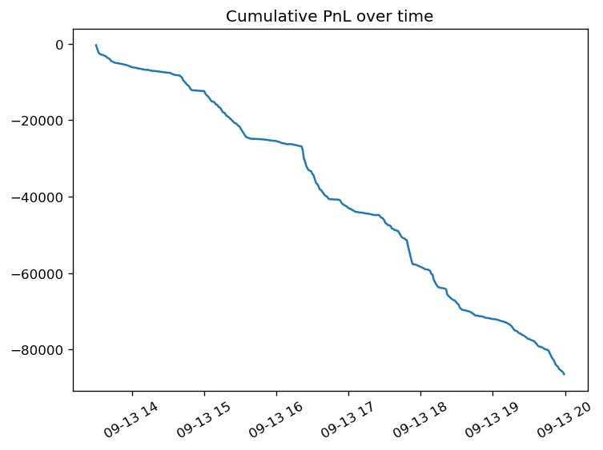
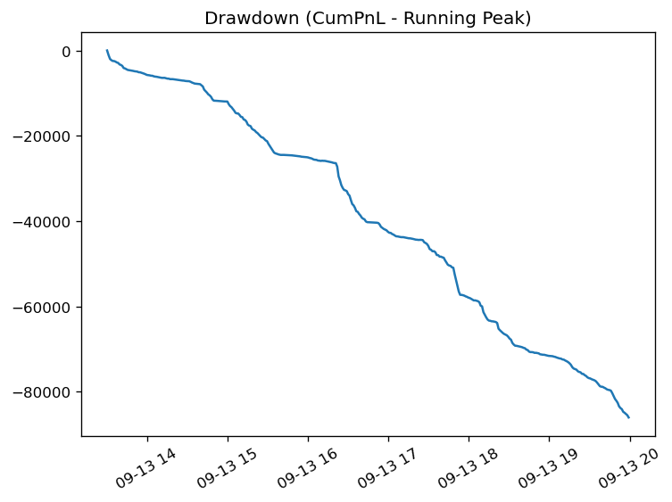
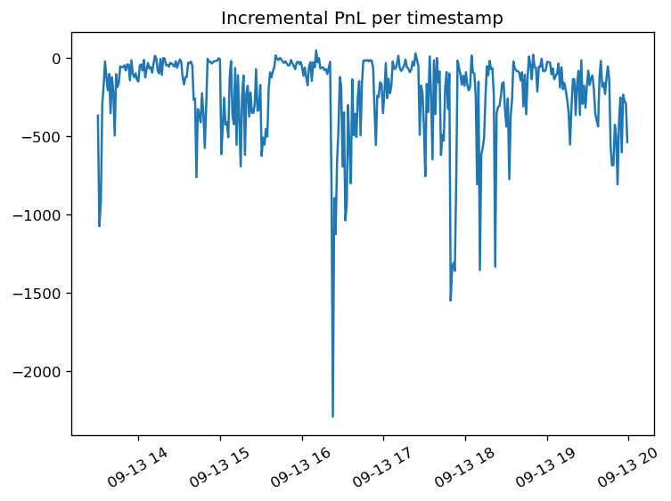
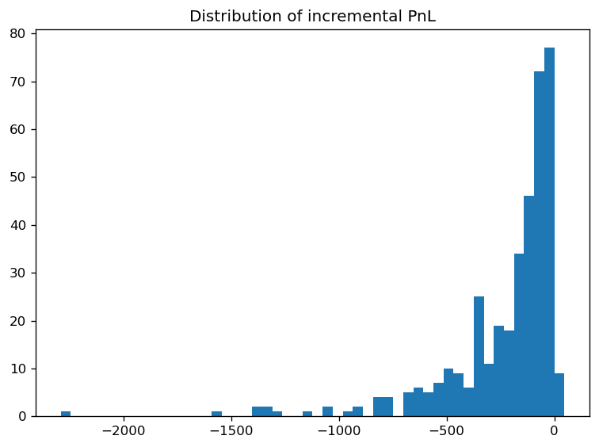

<h1 style="font-size: 3em; text-align: center;">FIN556 Report Group 4 – High-Frequency VWAP Strategy</h1>

- [1. Executive Summary](#1-executive-summary)
- [2. Meet the Team](#2-meet-the-team)
  - [Koki Yahata](#koki-yahata)
  - [Chia-Ning Chang](#Chia-Ning Chang)

- [3. Introduction to VWAP-Based Strategies](#3-introduction-to-vwap-based-strategies)
  - [3.1 VWAP Mean-Reversion Signal](#31-vwap-mean-reversion-signal)
  - [3.2 Maker vs. Taker Implementations](#32-maker-vs-taker-implementations)
- [4. Financial Instrument](#4-financial-instrument)
- [5. Market Data Analysis](#5-market-data-analysis)
- [6. Data Retrieval and Preprocessing](#6-data-retrieval-and-preprocessing)
  - [6.1 Order Book Updates (Quotes)](#61-order-book-updates-quotes)
  - [6.2 Trades and VWAP Construction](#62-trades-and-vwap-construction)
- [7. Strategy Design and Results](#7-strategy-design-and-results)
  - [7.1 Python Notebook Backtest (`vwap_based_strategy.ipynb`)](#71-python-notebook-backtest-vwap_based_strategyipynb)
  - [7.2 StrategyStudio Backtest + VWAP8 Output Diagnosis](#72-strategystudio-backtest--vwap8-output-diagnosis)
- [8. Future Implications and Improvements](#8-future-implications-and-improvements)

---

# 1. Executive Summary

This project focuses on designing and evaluating a **high-frequency VWAP-based trading strategy**. In the Python research notebook we use **SPY** (2020‑02‑12) as a concrete example dataset, while the StrategyStudio C++ strategy is instrument-agnostic and runs on any configured symbol list with valid trade/quote data. The core idea is to exploit **short-lived deviations between the mid-price and a rolling VWAP**, under the assumption that prices tend to revert toward VWAP over short horizons. Using intraday **order book updates** (323,759 quotes) and **trades** (6,127 prints) from the SPY sample day, we build a microstructure-aware signal that combines:

- Deviation of the mid-price from a **5-minute rolling VWAP** in basis points (bps), and
- **Order book imbalance** as a confirmation of buy or sell pressure.

We ran **two backtests of two different strategies**:

- **Python notebook backtest (`vwap_based_strategy.ipynb`)**: a research prototype that generates VWAP/imbalance signals and simulates a **maker-style** execution model (resting limit orders at best bid/ask) under conservative “strong signal only” criteria. It produced only **6 fills** and a small positive PnL of about **\$0.04**.
- **StrategyStudio C++ backtest (`src/VWAP.cpp`)**: a different strategy implementation that trades VWAP deviation as a **taker** using **market orders**, scaling inventory up to a cap and exiting when deviation crosses back through zero. The VWAP8 log analysis shows a **large negative PnL (~–\$86k)** with near-monotonic drawdown, dominated by aggressive execution costs and adverse selection.

---

# 2. Meet the Team

We are Group 4 in FIN556, combining experience in **algorithmic trading**, **high-performance systems**, and **machine learning**.

## Koki Yahata

I am a senior majoring in Computer Science. My focus is in algorithmic trading and web3 development. I develop market making strategies and on-chain arbitrage strategies. I am familiar with Python, Rust, C++, TypeScript, and Solidity.

Email: kyahata2@illinois.edu  
LinkedIn: [Koki Yahata](https://www.linkedin.com/in/koki-yahata)

## Chia-Ning Chang

I am a master student in Finance. My focus is in algorithmic trading strategy design and Portfolio Management. I develop all weather macro strategies on equities and double carry strategies on futures. I am familiar with Python.

Email: cc173@illinois.edu
LinkedIn: [Charlie Chang](https://www.linkedin.com/in/charlie-chianing-chang)

---

# 3. Introduction to VWAP-Based Strategies

## 3.1 VWAP Mean-Reversion Signal

The **Volume-Weighted Average Price (VWAP)** is a natural benchmark for intraday trading because it incorporates both **price** and **traded volume**. Our strategy assumes that when the observed mid-price drifts significantly away from a short-horizon VWAP, it is likely to **mean revert** in the near future.

From the notebook `vwap_based_strategy.ipynb`, we:

- Compute a **cumulative VWAP** and rolling **1-minute** and **5-minute** VWAPs from trades.  
- Align each trade with the nearest quote to obtain a **mid-price**, **spread in bps**, and **order book imbalance**.  
- Define **VWAP deviation** in bps:  
  \[
  \text{Deviation} = \frac{\text{Mid} - \text{VWAP}_{5\text{min}}}{\text{VWAP}_{5\text{min}}} \times 10,000 \text{ bps}
  \]
- Classify each timestamp into signals (`STRONG_BUY`, `BUY`, `NEUTRAL`, `SELL`, `STRONG_SELL`) based on deviation thresholds and imbalance.

The signal distribution is:

- **NEUTRAL:** 66.2% of observations  
- **BUY:** 17.5%  
- **SELL:** 16.0%  
- **STRONG_BUY / STRONG_SELL:** 0.1% each

This confirms that deviations beyond ±2 bps are relatively rare, and most of the time the mid-price stays close to VWAP.

## 3.2 Maker vs. Taker Implementations

We explored two ways of turning the VWAP signal into trades:

- **Notebook Maker Prototype (Limit Orders):**  
  - Only **STRONG BUY** and **STRONG SELL** signals are used.  
  - When flat and a strong signal appears, we **rest a limit order** at the best bid (for long) or best ask (for short).  
  - A fill occurs if the next trade prints through our limit price.  
  - Inventory is tightly controlled (targeting flat) and the maximum inventory is capped at 10 units.

- **StrategyStudio VWAPStrategy / VWAP8 (Market Orders):**  
  - Implemented in C++ (`VWAP.h` / `VWAP.cpp`) using RCM StrategyStudio.  
  - Uses **OnTrade** events to update a 5-minute rolling VWAP, combined with top-of-book quotes for mid-price.  
  - Signals are interpreted in a **taker-style** manner: when deviation crosses the entry threshold and inventory is below a cap, we send **market orders** (aggressively crossing the spread).  
  - Positions are exited when the deviation reverts toward zero (price crosses back through VWAP).

**Important note (strategy difference):** the Python notebook strategy and the C++ StrategyStudio strategy are not identical. The notebook backtest is a conservative, low-turnover **maker-style** prototype; the StrategyStudio `VWAPStrategy` in `src/VWAP.cpp` is a high-turnover **market-order taker** that can scale position (up to `max_inventory`) and therefore experiences very different execution frictions.

---

# 4. Financial Instrument

The **StrategyStudio C++ implementation** (`src/VWAP.cpp`) is **not limited to a single instrument**; it registers for events across the configured symbol list and can be run on any instrument for which the backtest provides valid trades/quotes.

In our **Python notebook backtest**, we use **SPY** intraday data as a concrete, liquid example to study VWAP deviation behavior and prototype a maker-style execution model. The analysis and plots in Sections 5–7.1 therefore reflect the SPY sample day, while the StrategyStudio section (7.2) is about the strategy behavior and execution mechanics more generally.

---

# 5. Market Data Analysis

The `vwap_based_strategy.ipynb` notebook performs several diagnostic analyses:

- **Price vs. VWAP Over Time:**  
  A figure compares trade prices against cumulative and 5-minute rolling VWAP. Visually, the trade price oscillates around VWAP, with deviations mostly within **±10 bps**, reinforcing the idea of short-term mean reversion but also highlighting how small the edge is in absolute terms.

- **Distribution of VWAP Deviations:**  
  A histogram of 5-minute deviation shows a roughly centered distribution with standard deviation around **2.38 bps**, and thresholds at ±2 bps capturing the outer tails of normal microstructure noise.

- **VWAP Deviation Over Time:**  
  Time-series plots of deviation, with horizontal lines at ±2 bps, show that **strong signals** are clustered and infrequent. Most of the intraday period sits in the neutral band.

- **Order Book Imbalance Over Time:**  
  The imbalance plot, shading positive (bid pressure) vs. negative (ask pressure), reveals alternating regimes of buy and sell pressure. This series is used as a **filter**, not a primary signal, to avoid trading mean-reversion in the wrong direction.

- **Signal Scatter Plot (Deviation vs. Imbalance):**  
  A scatter of deviation vs. imbalance, colored by signal label, visually confirms that **STRONG BUY** points lie in the lower-left quadrant (large negative deviation + strong bid pressure) and **STRONG SELL** points lie in the upper-right (large positive deviation + strong ask pressure), matching our economic intuition.

Together, these plots demonstrate that the VWAP-based signal is **statistically coherent** but operates on **very small price edges** relative to spread and fees—making execution model choice (maker vs taker) a first-order driver of realized performance.

---

# 6. Data Retrieval and Preprocessing

## 6.1 Order Book Updates (Quotes)

The quote data (`20200212_book_updates.csv.gz`) contains best bid/ask prices and sizes (and deeper levels for some analyses). Preprocessing steps in the notebook include:

- Parsing timestamps into `COLLECTION_TIME` and sorting by time.  
- Computing:  
  - **Mid-price:** \((\text{Bid}_1 + \text{Ask}_1) / 2\)  
  - **Spread (dollars and bps)**  
  - **Weighted mid-price** using the top three bid/ask levels  
  - **Bid/ask liquidity** and **order book imbalance**  
- Sampling quotes for plotting to keep visualizations readable while preserving intraday structure.

These features feed into both **signal generation** and diagnostic plots such as spread over time and imbalance heatmaps.

## 6.2 Trades and VWAP Construction

The trade data (`20200212_trades.csv.gz`) is used to compute:

- **Cumulative VWAP** from the start of the session, via running sums of price × size and volume.  
- **Rolling VWAPs** over 1-minute and 5-minute windows by filtering trades within a moving time window for each timestamp.  
- **Merged Trade–Quote Dataset** using `merge_asof`, aligning each trade to the latest quote to attach mid-price, spread, and imbalance.

From this merged dataset, we derive:

- **VWAP deviation** for multiple horizons (cumulative, 5-minute, 1-minute).  
- **Price momentum and percentage price changes.**  
- **Signal labels** (`STRONG_BUY`, `BUY`, `NEUTRAL`, `SELL`, `STRONG_SELL`) based on deviation and imbalance thresholds.  

The notebook also exports **`vwap_trading_signals.csv`** for later inspection and downstream backtesting.

---

# 7. Strategy Design and Results

## 7.1 Python Notebook Backtest (`vwap_based_strategy.ipynb`)

This section summarizes the backtest implemented in the Python notebook **`vwap_based_strategy.ipynb`** (research prototype).

### Strategy (Python): VWAP + Imbalance → Maker-style limit orders

Using VWAP signals computed from trades, we create discrete labels (`STRONG_BUY`, `BUY`, `NEUTRAL`, `SELL`, `STRONG_SELL`) based on:

- **Deviation threshold**: ±2 bps vs the **5-minute rolling VWAP**
- **Confirmation filter**: order book imbalance \(> 0.5\) for strong buy, \(< -0.5\) for strong sell

For the **maker backtest**, we only trade on **strong** signals and simulate passive execution:

- Enters only on **strong signals** (\(|\text{Deviation}| > 2 \text{ bps}\) and \(|\text{Imbalance}| > 0.5\)).  
- Places a **single-unit limit order** at the **best bid** (for `STRONG_BUY`) or **best ask** (for `STRONG_SELL`) when inventory is flat.  
- Considers the order **filled** if the next trade occurs at or through the limit price.  
- Prioritizes **liquidation**: if inventory is non-zero, it always places a closing limit order at the opposite side (best ask for long, best bid for short) before taking new signals.

### Results (Python backtest)

- **Total fills:** 6 trades  
- **Final inventory:** 0  
- **Total PnL:** approximately **\$0.04**  

The PnL is small because the entry conditions are extremely selective: **only 0.1%** of timestamps are `STRONG_BUY` and **0.1%** are `STRONG_SELL`, resulting in very low turnover.

## 7.2 StrategyStudio Backtest + VWAP8 Output Diagnosis

This section summarizes the StrategyStudio backtest of the **C++ `VWAPStrategy`** (`src/VWAP.cpp`) and uses **`research/VWAP8 Strategy_Analysis.ipynb`** to diagnose the generated `order.csv`, `fill.csv`, and `pnl.csv` logs.

### Implementation Highlights

- **VWAP Calculation:**  
  - Maintains a rolling **5-minute deque** (`VWAPTradeRecord`) of trade price/volume.  
  - On each trade, it updates cumulative price×volume and volume and prunes outdated trades.  
  - VWAP is available whenever there are at least a few trades or at least 60 seconds of history.

- **Signal and Execution Logic:**  
  - Triggered on **OnTrade** events to ensure VWAP uses actual transactions.  
  - Uses top-of-book quotes to compute the **mid-price** and deviation from the rolling VWAP in bps.  
  - **Entry**: when deviation is below \(-\text{entry\_threshold\_bps}\) → **market BUY**; above \(+\text{entry\_threshold\_bps}\) → **market SELL**, while \(|\text{position}| < \text{max\_inventory}\).  
  - **Exit**: when holding long and deviation crosses back to \(\ge 0\) (or holding short and deviation crosses back to \(\le 0\)), the strategy targets flat.

- **Parameters (typical run):**  
  - `vwap_window_seconds = 300` (5 minutes)  
  - `entry_threshold_bps` is runtime-configurable (default in code is **0.1 bps**, which makes trading very frequent unless raised)  
  - `max_inventory ≈ 5`  
  - `position_size = 1` share per trade  

### VWAP8 Analysis: PnL, Fills, and Execution

The notebook `VWAP8 Strategy_Analysis.ipynb` analyzes the **order**, **fill**, and **PnL** logs:

- **PnL Behavior:**  
  - The cumulative PnL starts around –\$369 and ends around **–\$86,429**, for a total loss of roughly **–\$86k**.  
  - The **max drawdown** is essentially the same magnitude, indicating a near-monotonic bleed with no sustained recovery.  
  - Incremental PnL is heavily skewed negative, with a low win rate (~20%) and occasional large negative outliers.

- **Execution Mechanics:**  
  - There are **9,826 fills** and the same number of orders, confirming the strategy trades very frequently.  
  - Almost all fills are classified as **liquidity removing** (crossing the spread), incurring spread costs and fees on every trade.  
  - Execution cost per minute and the count of “REMOVED” fills per minute are **positively associated with negative PnL**, i.e., the more aggressively we trade, the worse the outcome.

- **Intraday and Minute-Level Diagnostics:**  
  - Losses are spread across the entire session, with clusters during mid-to-late hours.  
  - Minute-by-minute analysis shows that the **worst PnL minutes** coincide with high trading intensity and high execution costs.  
  - The alignment of fills to per-minute PnL reveals that adverse selection and spread crossing, not rare shocks, drive the majority of the loss.

**Conclusion:** While the VWAP deviation signal is statistically reasonable, the **aggressive HFT implementation (VWAP8) is structurally unprofitable** in this configuration. Small 1–3 bps edges are overwhelmed by spread, fees, and adverse selection when trading at high frequency with market orders.

---

# 8. Future Implications and Improvements

The combined evidence from the research notebooks and StrategyStudio backtests suggests several lessons and future directions:

1. **Signal vs. Execution:**  
   - A clean theoretical signal (VWAP mean reversion) is not enough at HFT horizons.  
   - Execution style (limit vs. market) and microstructure frictions dominate realized PnL when signals operate at the 1–5 bps scale.

2. **Trading Intensity and Cost Control:**  
   - VWAP8’s large negative PnL stems from **overtrading with market orders** and systematically removing liquidity.  
   - Future versions should throttle trade frequency, incorporate **spread and volatility filters**, and prefer **maker-style entries** where feasible.

3. **Dynamic Thresholds and Regime Awareness:**  
   - Static ±2 bps thresholds are fragile; adaptive thresholds based on recent volatility or spread could better target true dislocations.  
   - Regime filters (e.g., avoiding high-volatility spikes or very wide spreads) can prevent trading when VWAP is itself unstable.

4. **Risk Management Extensions:**  
   - Add **hard stop-losses**, **max drawdown limits**, and **time-based exits** to prevent long periods of unbounded loss.  
   - Incorporate portfolio-level inventory caps if trading multiple symbols.

5. **Research Roadmap:**  
   - Explore hybrid strategies that **enter passively (maker)** on VWAP deviations but use **taker-style exits** only when necessary.  
   - Combine VWAP with other microstructure signals (e.g., imbalance dynamics, short-term momentum) to improve edge quality.  
   - Use the existing VWAP8 analysis framework (orders → fills → PnL) as a template for systematically debugging future HFT strategies.

Overall, this Version 1 report documents our path from a **statistically appealing VWAP signal** to a **fully implemented HFT strategy**, highlighting both what worked (signal design, tooling, diagnostics) and what failed (aggressive execution without sufficient cost control). It sets the stage for more robust VWAP-based strategies in future iterations of the project.

